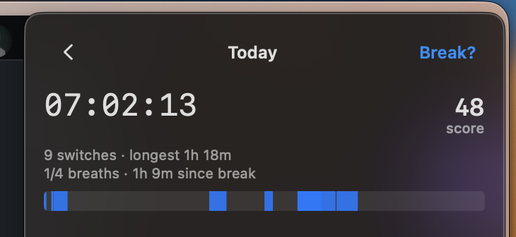
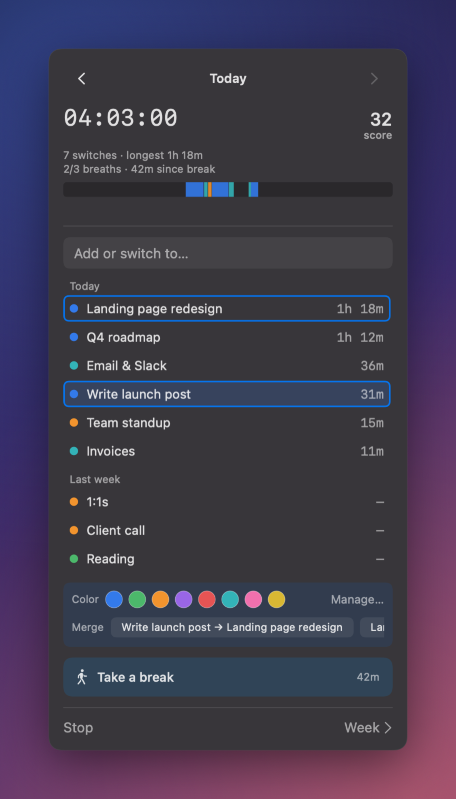
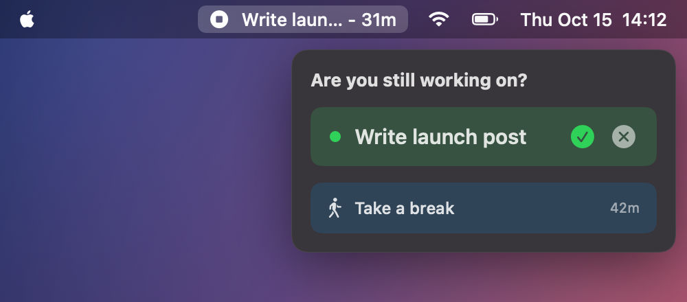
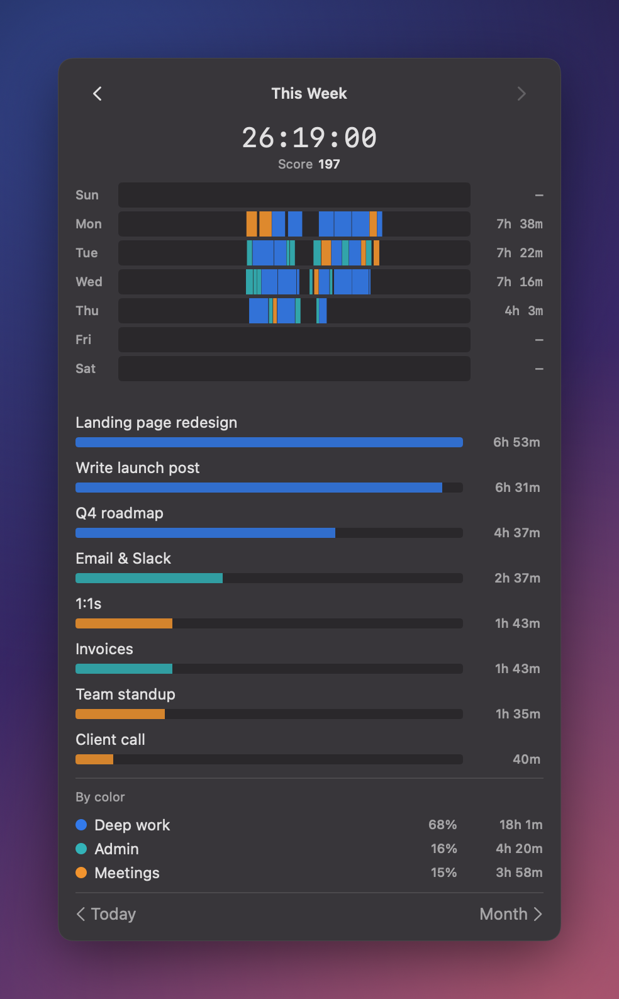
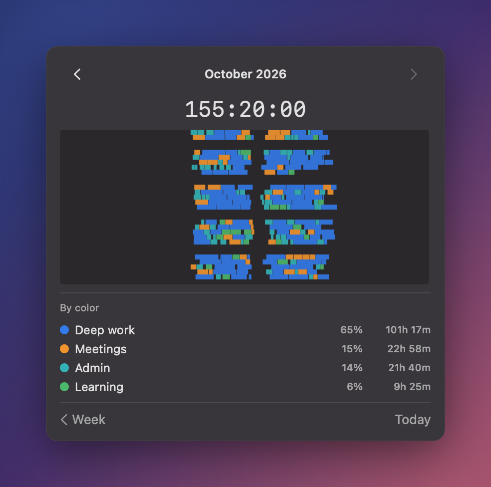
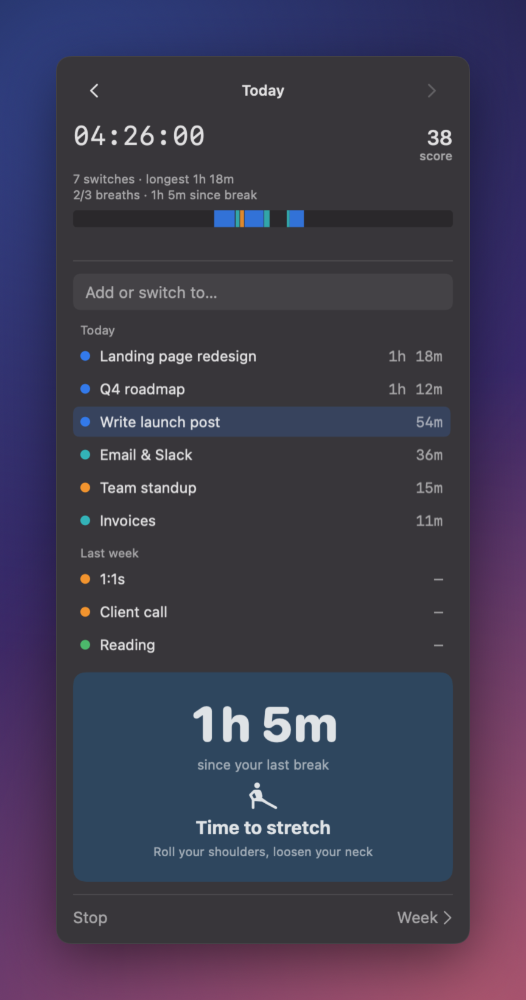
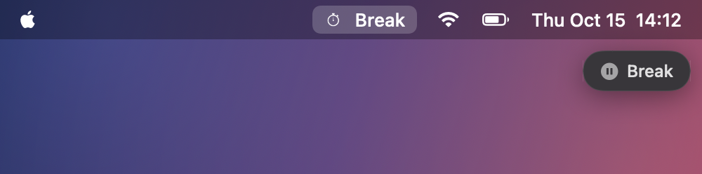
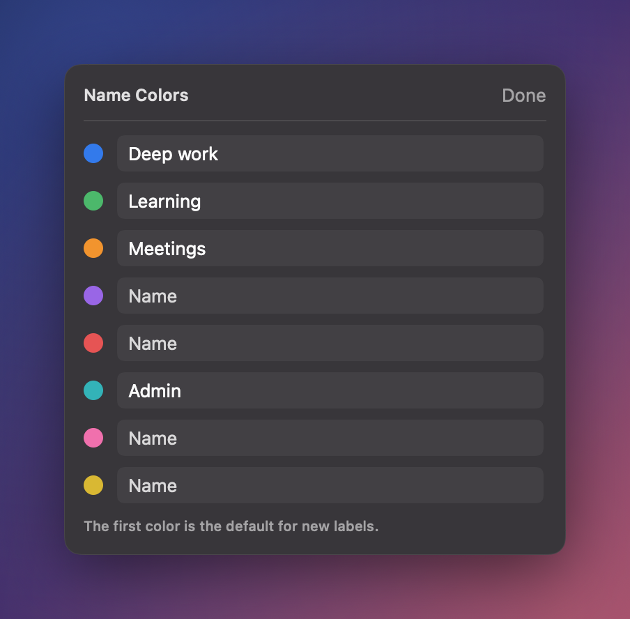

# TimTime

A time tracker for people who forget to start the timer.

Type what you're working on. TimTime does the rest. It lives in your Mac's menu bar, stops itself when you walk away, and nudges you to take a break.



## Get it

**[Buy TimTime for €9](https://www.ai-ascend.com/timtime)**. One payment, no subscription, free 1.x updates. macOS 14 Sonoma or later.

Open the DMG and drag **TimTime** to Applications. It lives in your menu bar (no Dock icon) and keeps itself up to date.

## Why

Most time trackers fail the same way. You forget to start them. Then you forget to stop them. By Friday the numbers are made up.

TimTime has no timers to manage.

- **Type a task and it starts.** Type the next one and it switches. No stop button.
- **Walk away and it stops.** After 5 minutes with no keyboard or mouse, it ends the task at the moment you left, not 5 minutes later. On a call (mic live), it keeps going.
- **Sit too long and it tells you.** A quiet check-in at 15 and 30 minutes. A break at 45.
- **See where it went.** Day, week, and month. Colors for the kinds of work you do. A simple daily score for long focus blocks and real breaks.

## What it looks like

| Color your work | The check-in |
|---|---|
|  |  |
| Shift-click any labels to color or merge them. Totals roll up by color. | Two light nudges, then a break. Ignore one and nothing breaks. |

| This week | This month |
|---|---|
|  |  |
| Every day is a 24 hour strip. Hover a task to light it up. | The whole month at a glance, with percentages by color. |

| 45 minutes in | On a break |
|---|---|
|  |  |
| The "take a break" button grows when you're overdue. | Not tracking? A small pill sits under the menu bar so you don't forget you're off the clock. |

Name your colors (Deep work, Meetings, Admin) and leave the rest blank:



The screenshots use made-up data. See [Regenerating screenshots](#regenerating-screenshots).

## What it will and won't do

- **It never reads what you type.** To know if you're away it reads three things from macOS: how long since the last input, whether a mic is live, and whether something is keeping the display awake. It can't tell a keystroke from a mouse move, never sees which key, and never looks at your screen. No Accessibility, no Screen Recording, no permission prompts.
- **Your data stays on your Mac.** Plain JSON in `~/Library/Application Support/TimTime/`. No account, no cloud, no analytics.
- **Entries are append-only.** Renaming or merging a label rewrites its name. It never deletes your time.
- **Updates itself** with [Sparkle](https://sparkle-project.org). Signed and notarized.

## Help me make it better

I'm using it every day and I'd like to know what breaks for you. [Open an issue](https://github.com/timmayyyy/timtime/issues) or email tim@ai-ascend.com.

The source is right here. If you really want it for free, [build it yourself](#build-from-source). No hard feelings.

## Build from source

Requires macOS 14+ and Xcode 26 (Sparkle is pulled in via Swift Package Manager automatically).

```sh
open "Tim Time/Tim Time.xcodeproj"   # then hit Run
```

Architecture notes and the full release pipeline are in [CLAUDE.md](CLAUDE.md).

## Regenerating screenshots

```sh
"Tim Time/scripts/screenshots/build.sh"
```

Renders the app's real SwiftUI views against invented data and a fixed clock, so no real entries ever appear. It needs no Screen Recording permission and never touches your real data folder.

## Project layout

| Path | What |
|------|------|
| `Tim Time/Tim Time/` | Swift sources (SwiftUI + AppKit menu bar) |
| `Tim Time/Info.plist` | Sparkle keys (feed URL, public key) |
| `Tim Time/scripts/release.sh` | archive → notarize → staple → DMG → Sparkle-sign |
| `Tim Time/scripts/screenshots/` | Screenshot generator (fake data, fixed clock) |
| `appcast.xml` | Sparkle update feed (served via GitHub Pages) |
| `icon-composer-source/` | layered icon art for Icon Composer |

## License

© 2026 Tim Burnham. All rights reserved. Source-available, not currently licensed for redistribution. (Open an issue if you'd like a different arrangement.)
