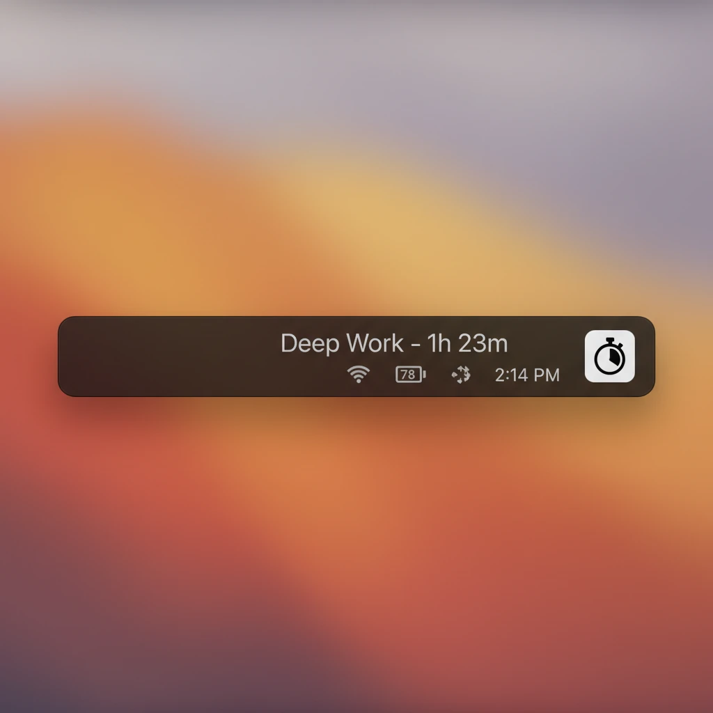

# TimTime

A minimalist macOS **menu bar time tracker**. Type what you're working on and it tracks it — with gentle nudges to take breaks. SwiftUI, signed + notarized, auto-updating.



## Download

**[⬇ Download TimTime](https://github.com/timmayyyy/timtime/releases/latest/download/TimTime.dmg)** — requires macOS 14 (Sonoma) or later.

Open the DMG and drag **TimTime** to Applications. It lives in your menu bar (no Dock icon) and keeps itself up to date.

## Features

- **Switch-to-start** — type or click a label and it instantly closes the previous task and starts the new one
- **At a glance** — current task + today's total, right in the menu bar
- **Daily & weekly breakdown** — see where your time goes, with a weekly chart
- **Gentle nudges** — a deterministic 15 / 15 / 45 cycle: two quick "still on it?" checks, then a breath/break prompt
- **Local & append-only** — your data never leaves your Mac (`~/Library/Application Support/TimTime/`)
- **Auto-updates** via [Sparkle](https://sparkle-project.org)

## Build from source

Requires macOS 14+ and Xcode 26 (Sparkle is pulled in via Swift Package Manager automatically).

```sh
open "Tim Time/Tim Time.xcodeproj"   # then hit Run
```

Architecture notes and the full release pipeline are in [CLAUDE.md](CLAUDE.md).

## Project layout

| Path | What |
|------|------|
| `Tim Time/Tim Time/` | Swift sources (SwiftUI + AppKit menu bar) |
| `Tim Time/Info.plist` | Sparkle keys (feed URL, public key) |
| `Tim Time/scripts/release.sh` | archive → notarize → staple → DMG → Sparkle-sign |
| `appcast.xml` | Sparkle update feed (served via GitHub Pages) |
| `icon-composer-source/` | layered icon art for Icon Composer |

## License

© 2026 Tim Burnham. All rights reserved — source-available, not currently licensed for redistribution. (Open an issue if you'd like a different arrangement.)
